# Diagrams

How Swiss Grounding works, drawn from the code. Each diagram is a self-contained HTML file (open it in a browser; hover the canton map for details) with a PNG export next to it. Numbers carry the date they were counted. The jury presentation versions live in [`presentation/diagrams/`](../../presentation/diagrams/).

## Ingestion

### 01 · Corpus pipeline

Building the corpus from an empty database, in the order the commands run. Collecting is free but slow. The enrich stage is the only one that spends money, and every paid step checks CORPUS_BUDGET_USD before it spends; corpus run runs the whole column and resumes where it stopped.

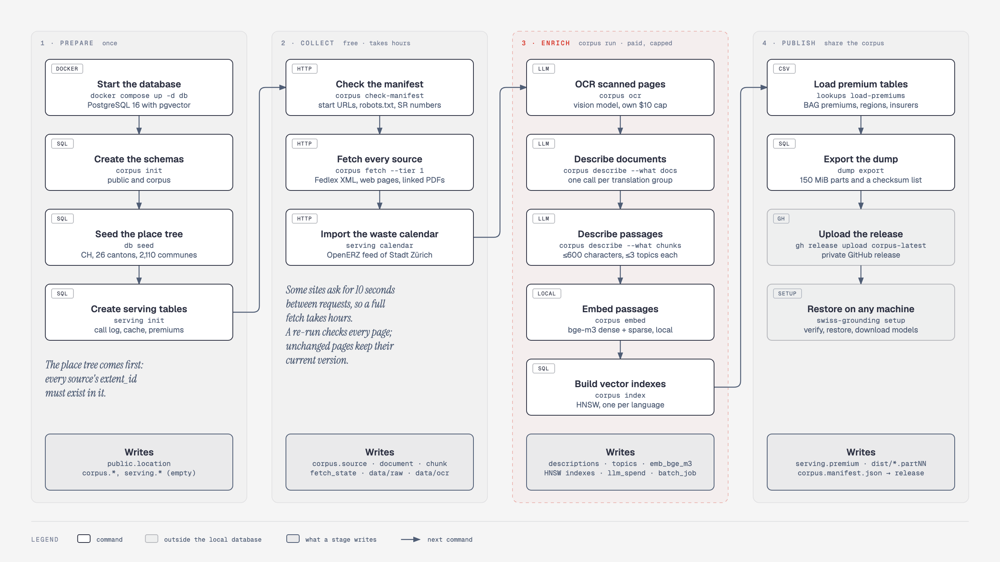

[HTML](01-corpus-pipeline.html) · code: [`docs/MAINTAINING.md`](../../docs/MAINTAINING.md) · [`src/swiss_grounding/cli/corpus_commands.py`](../../src/swiss_grounding/cli/corpus_commands.py) · [`src/swiss_grounding/cli/corpus_run.py`](../../src/swiss_grounding/cli/corpus_run.py) · [`src/swiss_grounding/cli/serving_commands.py`](../../src/swiss_grounding/cli/serving_commands.py)

### 02 · Adding a source

A source exists only because a person declared it in manifests/declared-scope.yaml. The example is the real Vaud entry. Authority and jurisdiction come from the entry and are never guessed from the page text; the same URL can only ever belong to one source.

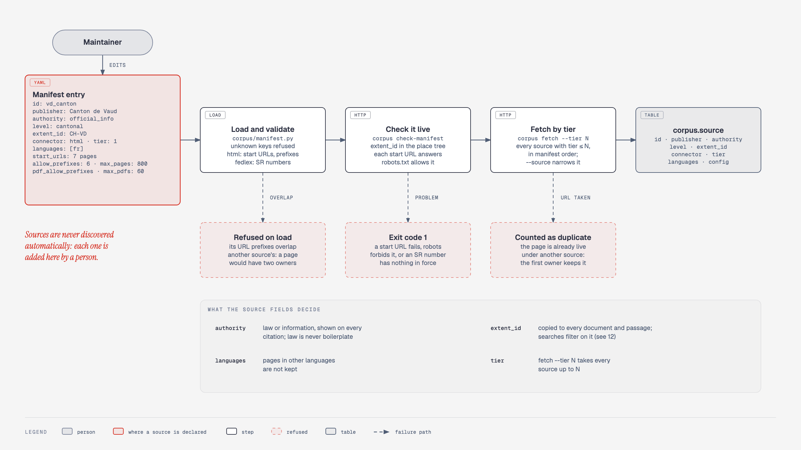

[HTML](02-adding-a-source.html) · code: [`manifests/declared-scope.yaml`](../../manifests/declared-scope.yaml) · [`src/swiss_grounding/corpus/manifest.py`](../../src/swiss_grounding/corpus/manifest.py) · [`src/swiss_grounding/cli/corpus_source_commands.py`](../../src/swiss_grounding/cli/corpus_source_commands.py) · [`src/swiss_grounding/corpus/persist.py`](../../src/swiss_grounding/corpus/persist.py)

### 03 · HTML crawl

What the web connector does for each source. New and linked pages are fetched in full; pages known from an earlier run are revisited last with a conditional request. Each host is throttled across all threads, and robots.txt is obeyed unless RESPECT_ROBOTS is turned off.

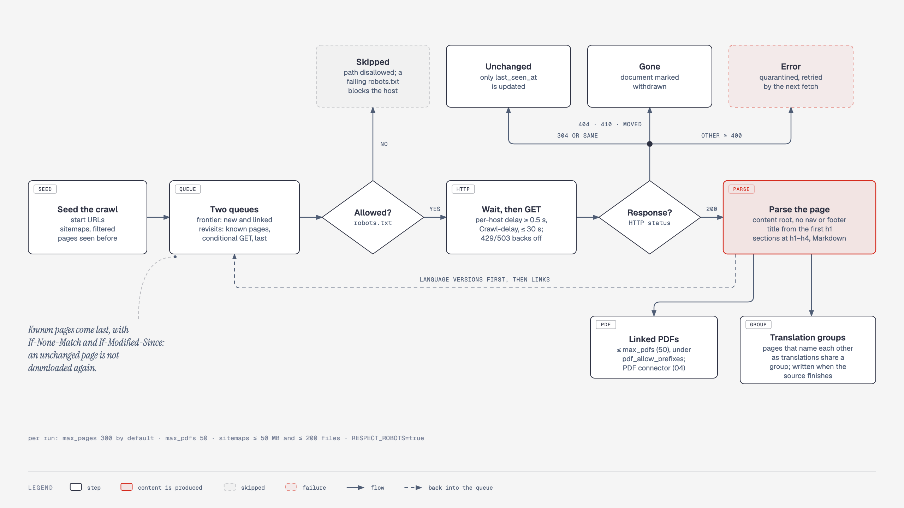

[HTML](03-html-crawl.html) · code: [`src/swiss_grounding/corpus/connectors/html.py`](../../src/swiss_grounding/corpus/connectors/html.py) · [`src/swiss_grounding/corpus/connectors/crawl_queue.py`](../../src/swiss_grounding/corpus/connectors/crawl_queue.py) · [`src/swiss_grounding/corpus/connectors/politeness.py`](../../src/swiss_grounding/corpus/connectors/politeness.py) · [`src/swiss_grounding/corpus/connectors/sitemap.py`](../../src/swiss_grounding/corpus/connectors/sitemap.py) · [`src/swiss_grounding/corpus/connectors/html_meta.py`](../../src/swiss_grounding/corpus/connectors/html_meta.py) · [`src/swiss_grounding/ingest/html_sections.py`](../../src/swiss_grounding/ingest/html_sections.py)

### 04 · Fedlex, PDF and feed connectors

The three other ways content enters the corpus. Fedlex law carries its validity dates and is kept aligned across languages; PDFs are only fetched when a crawled page links to them; a JSON feed needs an importer of its own, as the OpenERZ waste calendar has.

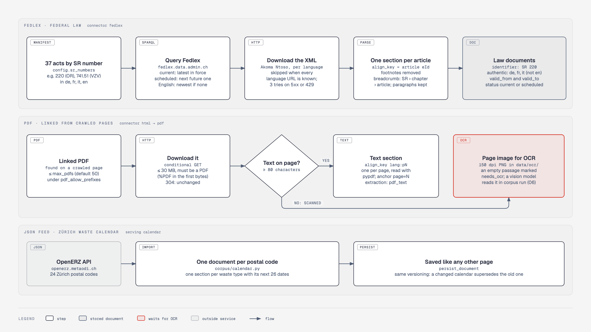

[HTML](04-fedlex-pdf-feeds.html) · code: [`src/swiss_grounding/corpus/connectors/fedlex.py`](../../src/swiss_grounding/corpus/connectors/fedlex.py) · [`src/swiss_grounding/corpus/connectors/fedlex_akn.py`](../../src/swiss_grounding/corpus/connectors/fedlex_akn.py) · [`src/swiss_grounding/corpus/connectors/pdf.py`](../../src/swiss_grounding/corpus/connectors/pdf.py) · [`src/swiss_grounding/corpus/calendar.py`](../../src/swiss_grounding/corpus/calendar.py)

### 05 · Chunking and alignment

Every passage keeps its section's breadcrumb and anchor, its order in the document, and a hash of its text (the image digest for a scanned page). Legal abbreviations such as Art., Abs., lit. and Ziff. never count as a sentence end. The law example is real: Art. 336c OR is split into three paragraphs in all four languages.

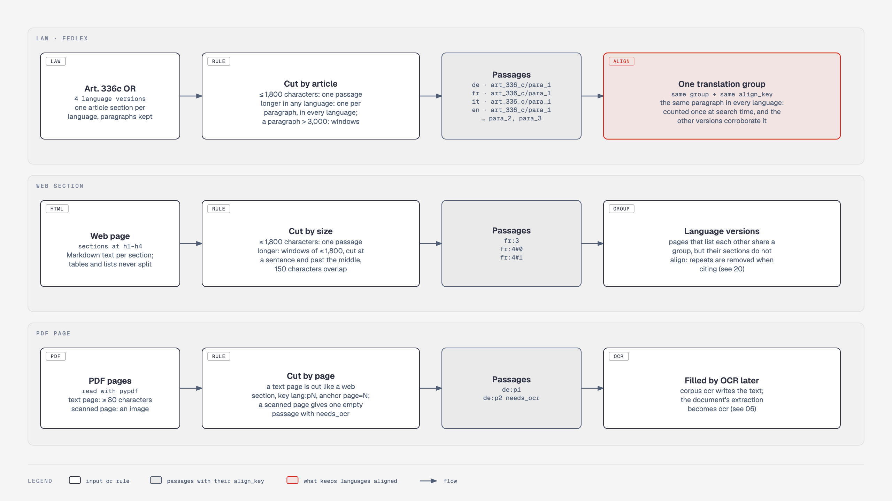

[HTML](05-chunking-alignment.html) · code: [`src/swiss_grounding/corpus/chunker.py`](../../src/swiss_grounding/corpus/chunker.py) · [`src/swiss_grounding/corpus/connectors/fedlex.py`](../../src/swiss_grounding/corpus/connectors/fedlex.py) · [`src/swiss_grounding/corpus/persist.py`](../../src/swiss_grounding/corpus/persist.py)

### 06 · OCR, descriptions and embeddings

The enrich stage of corpus run. Descriptions are written in each language the text exists in and are part of both the embedded text and the keyword index. Embeddings run locally with bge-m3; the OpenAI index is opt-in, paid, and left out of the published dump.

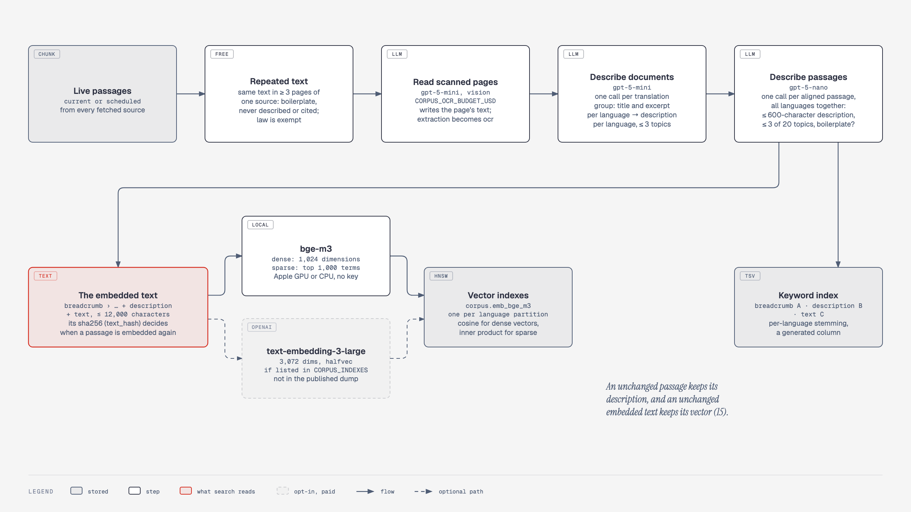

[HTML](06-describe-embed.html) · code: [`src/swiss_grounding/corpus/describe.py`](../../src/swiss_grounding/corpus/describe.py) · [`src/swiss_grounding/corpus/ocr.py`](../../src/swiss_grounding/corpus/ocr.py) · [`src/swiss_grounding/corpus/embed.py`](../../src/swiss_grounding/corpus/embed.py) · [`src/swiss_grounding/corpus/providers.py`](../../src/swiss_grounding/corpus/providers.py) · [`src/swiss_grounding/corpus/schema.sql`](../../src/swiss_grounding/corpus/schema.sql)

### 07 · Cost control

How the paid stages stay under CORPUS_BUDGET_USD (and OCR under CORPUS_OCR_BUDGET_USD). Prices per model live in corpus/budget.py; batch prices are half the direct price. Batches still in flight count against the cap, so a second run cannot overspend.

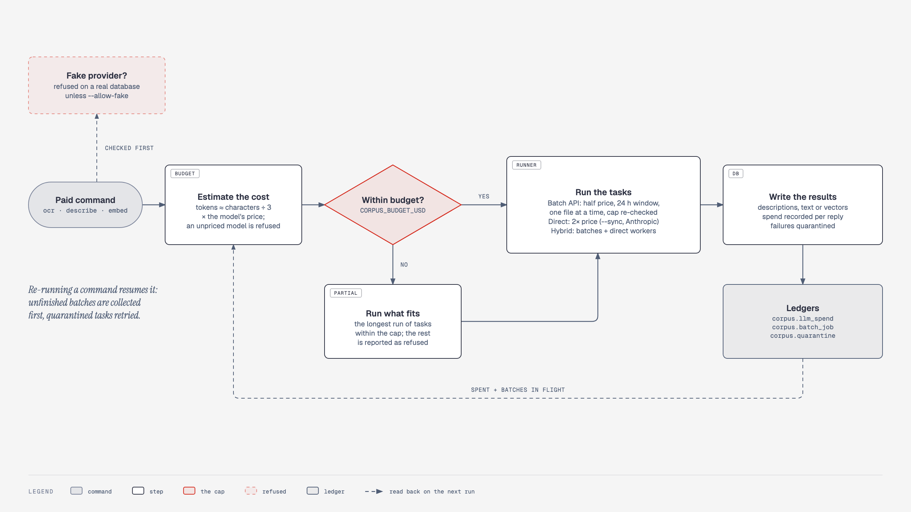

[HTML](07-cost-control.html) · code: [`src/swiss_grounding/corpus/budget.py`](../../src/swiss_grounding/corpus/budget.py) · [`src/swiss_grounding/corpus/runner.py`](../../src/swiss_grounding/corpus/runner.py) · [`src/swiss_grounding/corpus/hybrid_runner.py`](../../src/swiss_grounding/corpus/hybrid_runner.py) · [`src/swiss_grounding/cli/corpus_commands.py`](../../src/swiss_grounding/cli/corpus_commands.py) · [`src/swiss_grounding/corpus/providers.py`](../../src/swiss_grounding/corpus/providers.py)

## Storage

### 08 · The place tree

public.location holds every place a question or a source can name: Switzerland, the 26 cantons, the 2,110 communes of the BFS register and 46 neighborhoods of the city of Zürich, each row with its full path from CH. Cantons carry labels in four languages; communes carry their German name plus aliases. The dashed red area is the declared scope: cantonal information for six cantons and municipal services for seven cities; federal information covers every place. Row counts from the local database on 25 September 2026.

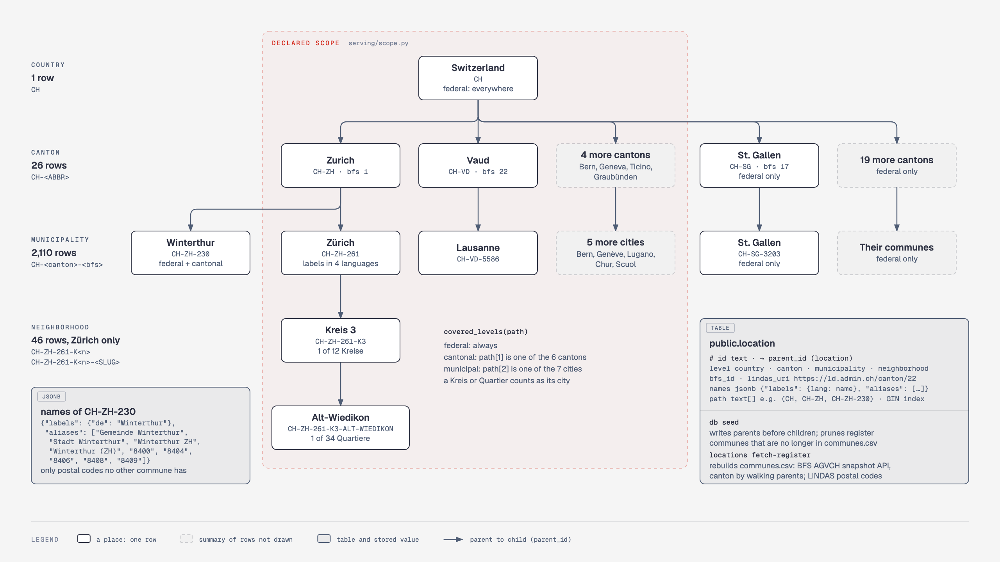

[HTML](08-place-tree.html) · code: [`src/swiss_grounding/db/schema.sql`](../../src/swiss_grounding/db/schema.sql) · [`src/swiss_grounding/locations/seed.py`](../../src/swiss_grounding/locations/seed.py) · [`src/swiss_grounding/locations/register.py`](../../src/swiss_grounding/locations/register.py) · [`src/swiss_grounding/locations/register_fetch.py`](../../src/swiss_grounding/locations/register_fetch.py) · [`src/swiss_grounding/locations/repository.py`](../../src/swiss_grounding/locations/repository.py) · [`src/swiss_grounding/serving/scope.py`](../../src/swiss_grounding/serving/scope.py)

### 09 · Coverage by canton

How much local data each canton has: passages from the canton's own site and from its covered cities' sites, counted in the local corpus. Federal sources apply everywhere and are not part of the shading. Hover a canton for its sources.

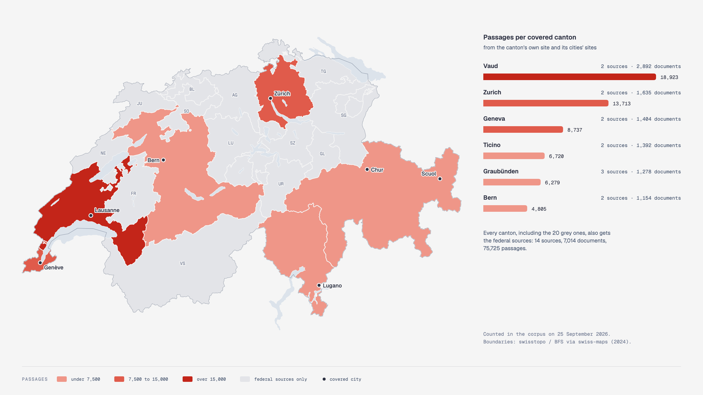

[HTML](09-coverage-map.html) · code: [`manifests/declared-scope.yaml`](../../manifests/declared-scope.yaml) · [`src/swiss_grounding/serving/scope.py`](../../src/swiss_grounding/serving/scope.py)

### 10 · Data model

The tables in three schemas. public.location is the place tree (08). corpus holds the sources, the documents and their passages (corpus.chunk) with their vectors; passages and vectors are partitioned by language (de, fr, it, en, rm). serving holds what the running server needs besides the corpus. extent_id, in red, is where a place meets the data. The v1 tables that db init still creates in public (source, document, chunk and others) are left out.

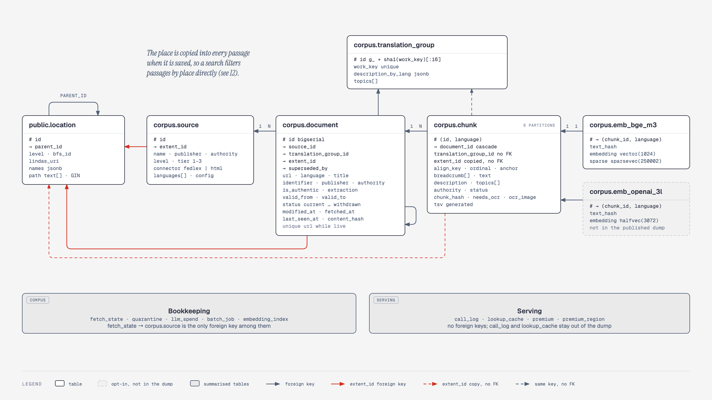

[HTML](10-data-model.html) · code: [`src/swiss_grounding/db/schema.sql`](../../src/swiss_grounding/db/schema.sql) · [`src/swiss_grounding/corpus/schema.sql`](../../src/swiss_grounding/corpus/schema.sql) · [`src/swiss_grounding/serving/schema.sql`](../../src/swiss_grounding/serving/schema.sql) · [`src/swiss_grounding/corpus/persist.py`](../../src/swiss_grounding/corpus/persist.py) · [`src/swiss_grounding/serving/dump.py`](../../src/swiss_grounding/serving/dump.py)

### 11 · Anatomy of a passage

Every field of one corpus.chunk row, grouped by what it is for, with the values of a real passage: the first paragraph of Art. 336c of the Code of Obligations (SR 220) in German, as stored in the local corpus on 25 September 2026. The document's fields are joined when a search reads the passage; its vectors live in corpus.emb_bge_m3. authority comes from the source: only Fedlex is law, and Schweizer Wanderwege is the one institutional source. On that day this passage had no description yet.

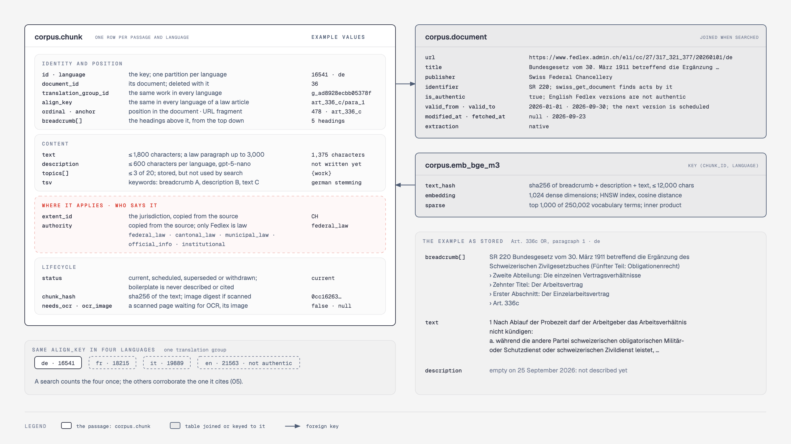

[HTML](11-passage-anatomy.html) · code: [`src/swiss_grounding/corpus/schema.sql`](../../src/swiss_grounding/corpus/schema.sql) · [`src/swiss_grounding/corpus/chunker.py`](../../src/swiss_grounding/corpus/chunker.py) · [`src/swiss_grounding/corpus/persist.py`](../../src/swiss_grounding/corpus/persist.py) · [`src/swiss_grounding/corpus/describe.py`](../../src/swiss_grounding/corpus/describe.py) · [`src/swiss_grounding/corpus/embed.py`](../../src/swiss_grounding/corpus/embed.py) · [`src/swiss_grounding/serving/candidates.py`](../../src/swiss_grounding/serving/candidates.py)

### 12 · How a place links to a source

A place is attached to the data once, when a document is saved, and used on every search. The source's extent_id, set by hand in the manifest, is copied into each document and passage. A question's place is resolved to its path in the place tree, the path is cut where the declared scope stops, and only passages whose extent_id lies on the remaining path are candidates. A citation's tier counts the levels from the deepest one searched up to CH, so for Winterthur a Zurich passage has tier 0.

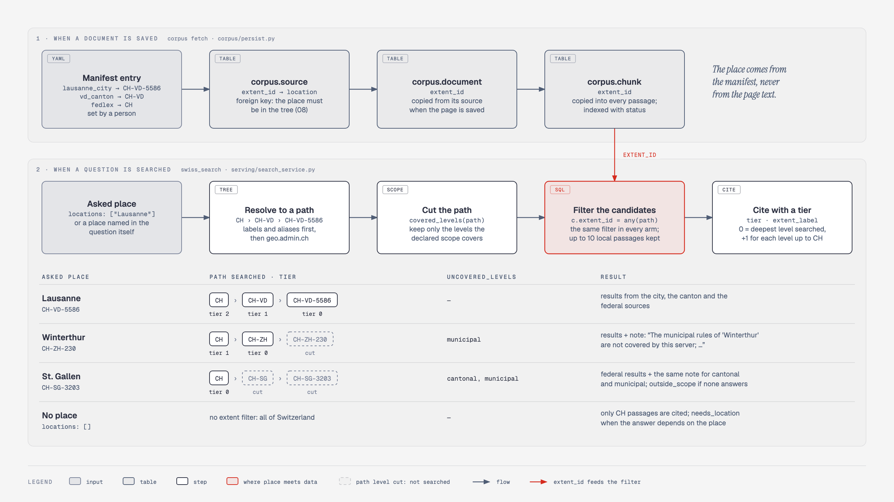

[HTML](12-place-source-link.html) · code: [`manifests/declared-scope.yaml`](../../manifests/declared-scope.yaml) · [`src/swiss_grounding/corpus/persist.py`](../../src/swiss_grounding/corpus/persist.py) · [`src/swiss_grounding/serving/places.py`](../../src/swiss_grounding/serving/places.py) · [`src/swiss_grounding/serving/scope.py`](../../src/swiss_grounding/serving/scope.py) · [`src/swiss_grounding/serving/search_service.py`](../../src/swiss_grounding/serving/search_service.py) · [`src/swiss_grounding/serving/candidates.py`](../../src/swiss_grounding/serving/candidates.py) · [`src/swiss_grounding/serving/status.py`](../../src/swiss_grounding/serving/status.py)

## Refresh

### 13 · Refresh rules per page

What a re-run of corpus fetch does to every URL it sees. Nothing is scheduled: a maintainer re-runs corpus fetch, then corpus run. Each source reports its added, modified, unchanged, withdrawn, duplicate and failed counts; a whole source that fails is quarantined as source:<id>. When every source is done, scheduled law versions whose start date has arrived become current.

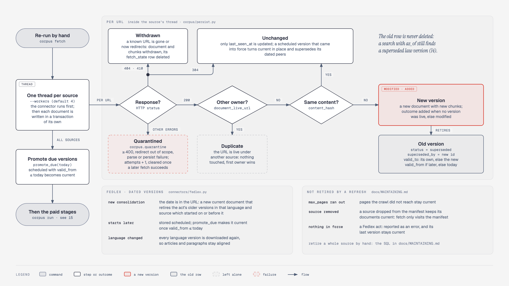

[HTML](13-refresh-rules.html) · code: [`src/swiss_grounding/corpus/fetch_stage.py`](../../src/swiss_grounding/corpus/fetch_stage.py) · [`src/swiss_grounding/corpus/persist.py`](../../src/swiss_grounding/corpus/persist.py) · [`src/swiss_grounding/corpus/connectors/html.py`](../../src/swiss_grounding/corpus/connectors/html.py) · [`src/swiss_grounding/corpus/connectors/fedlex.py`](../../src/swiss_grounding/corpus/connectors/fedlex.py) · [`docs/MAINTAINING.md`](../../docs/MAINTAINING.md)

### 14 · Document version lifecycle

The status of a corpus.document row, and what changes it. Only law has dates: a Fedlex consolidation carries valid_from and valid_to, a web page or PDF has neither. A row is superseded when its URL returns changed content, or when a newer dated version of the same act, language and source takes over; promote_due also retires a scheduled version that a current one starting on the same day or later has overtaken. A passage takes its document's status, except boilerplate.

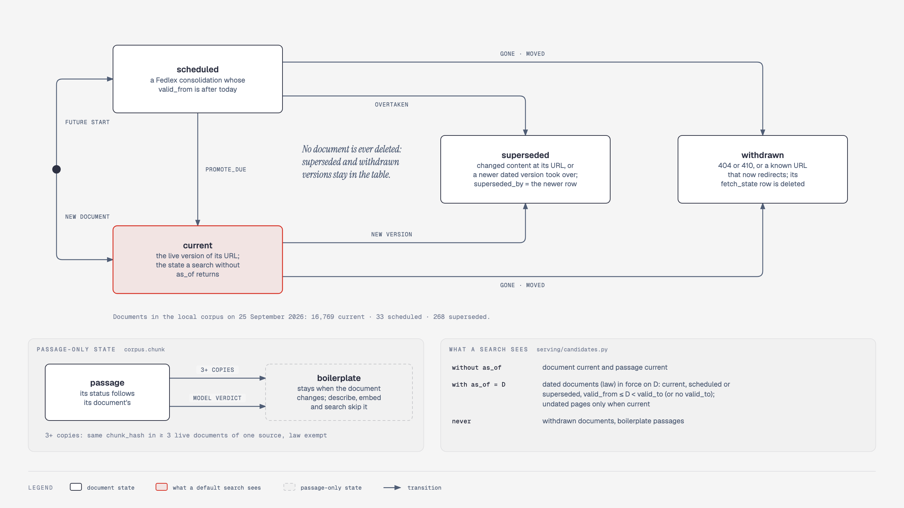

[HTML](14-document-lifecycle.html) · code: [`src/swiss_grounding/corpus/persist.py`](../../src/swiss_grounding/corpus/persist.py) · [`src/swiss_grounding/corpus/connectors/fedlex.py`](../../src/swiss_grounding/corpus/connectors/fedlex.py) · [`src/swiss_grounding/corpus/describe.py`](../../src/swiss_grounding/corpus/describe.py) · [`src/swiss_grounding/corpus/schema.sql`](../../src/swiss_grounding/corpus/schema.sql) · [`src/swiss_grounding/serving/candidates.py`](../../src/swiss_grounding/serving/candidates.py)

### 15 · Paid work reused on refresh

Why a refresh costs little. A description is tied to the chunk's text, a vector to the exact text it was made from; when a new version keeps a passage word for word, both are copied instead of paid for again. Only a changed or new passage reaches the describe call and the embedding model.

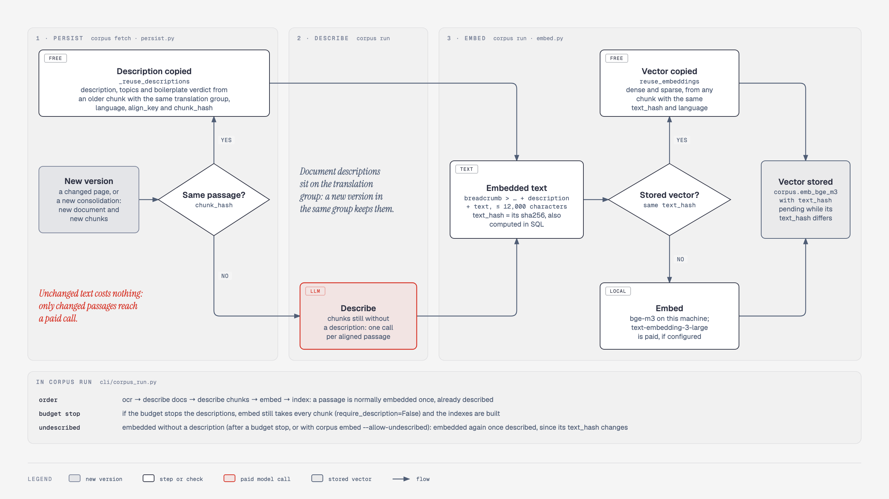

[HTML](15-reuse-paid-work.html) · code: [`src/swiss_grounding/corpus/persist.py`](../../src/swiss_grounding/corpus/persist.py) · [`src/swiss_grounding/corpus/embed.py`](../../src/swiss_grounding/corpus/embed.py) · [`src/swiss_grounding/corpus/describe.py`](../../src/swiss_grounding/corpus/describe.py) · [`src/swiss_grounding/cli/corpus_run.py`](../../src/swiss_grounding/cli/corpus_run.py) · [`src/swiss_grounding/cli/corpus_commands.py`](../../src/swiss_grounding/cli/corpus_commands.py)

## Retrieval

### 16 · Which tool answers what

The server exposes six tools of its own and forwards the zbern_* tools. It never decides which tool answers a question: the chat model chooses from the server instructions and the tool descriptions. The zbern_* tools are served only when ZBERN_MCP_TOKEN is set; the tool annotations are the zone subtitles.

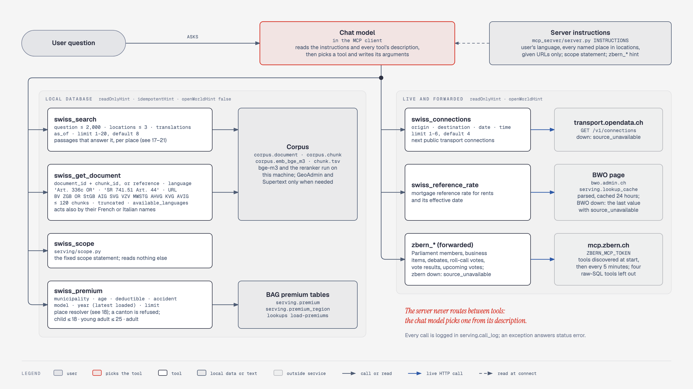

[HTML](16-tool-map.html) · code: [`src/swiss_grounding/mcp_server/server.py`](../../src/swiss_grounding/mcp_server/server.py) · [`src/swiss_grounding/mcp_server/zbern.py`](../../src/swiss_grounding/mcp_server/zbern.py) · [`src/swiss_grounding/serving/documents.py`](../../src/swiss_grounding/serving/documents.py) · [`src/swiss_grounding/serving/scope.py`](../../src/swiss_grounding/serving/scope.py) · [`src/swiss_grounding/lookups/premium.py`](../../src/swiss_grounding/lookups/premium.py) · [`src/swiss_grounding/lookups/connections.py`](../../src/swiss_grounding/lookups/connections.py) · [`src/swiss_grounding/lookups/reference_rate.py`](../../src/swiss_grounding/lookups/reference_rate.py) · [`src/swiss_grounding/config.py`](../../src/swiss_grounding/config.py)

### 17 · swiss_search overview

What one swiss_search call does. Places come back one result each, never merged. Steps 2 to 4 run once for the request; steps 5 to 10 run for every place that is searched, and the reranker's scores are shared between those places. Without SUPERTEXT_API_KEY nothing is translated.

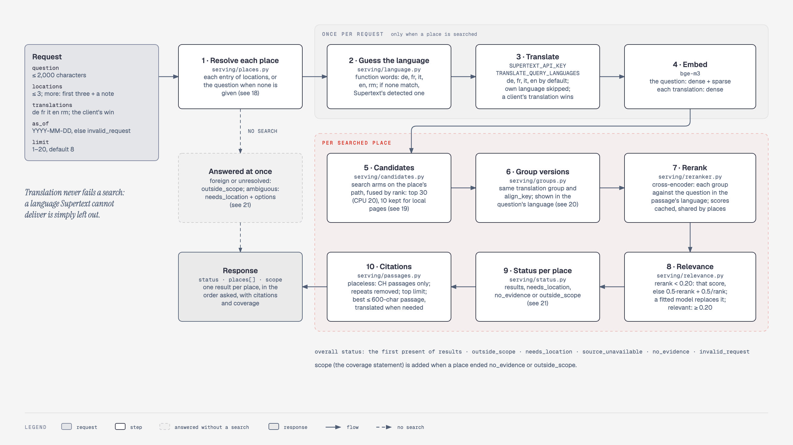

[HTML](17-search-overview.html) · code: [`src/swiss_grounding/serving/search_service.py`](../../src/swiss_grounding/serving/search_service.py) · [`src/swiss_grounding/mcp_server/server.py`](../../src/swiss_grounding/mcp_server/server.py) · [`src/swiss_grounding/serving/models.py`](../../src/swiss_grounding/serving/models.py) · [`src/swiss_grounding/serving/language.py`](../../src/swiss_grounding/serving/language.py) · [`src/swiss_grounding/serving/translation.py`](../../src/swiss_grounding/serving/translation.py) · [`src/swiss_grounding/serving/places.py`](../../src/swiss_grounding/serving/places.py)

### 18 · Place resolution

How swiss_search turns a place into the extents it searches. Each locations entry runs down the left ladder until something matches; with no locations the question itself is scanned. Failures are answered before any search (see 21). A resolved place is searched on its path from CH down, cut at the last level the declared scope covers; swiss_premium resolves its municipality the same way.

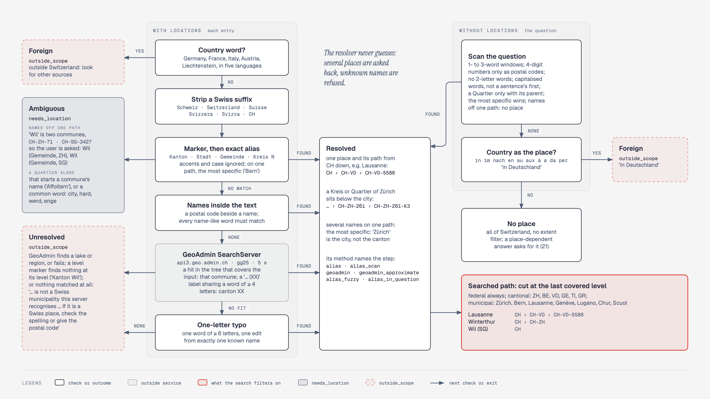

[HTML](18-place-resolution.html) · code: [`src/swiss_grounding/serving/places.py`](../../src/swiss_grounding/serving/places.py) · [`src/swiss_grounding/locations/resolver.py`](../../src/swiss_grounding/locations/resolver.py) · [`src/swiss_grounding/locations/question_scan.py`](../../src/swiss_grounding/locations/question_scan.py) · [`src/swiss_grounding/locations/markers.py`](../../src/swiss_grounding/locations/markers.py) · [`src/swiss_grounding/locations/geoadmin.py`](../../src/swiss_grounding/locations/geoadmin.py) · [`src/swiss_grounding/locations/fuzzy.py`](../../src/swiss_grounding/locations/fuzzy.py) · [`src/swiss_grounding/locations/tree.py`](../../src/swiss_grounding/locations/tree.py) · [`src/swiss_grounding/serving/scope.py`](../../src/swiss_grounding/serving/scope.py)

### 19 · Search arms and rank fusion

Step 5 of swiss_search. The dense arm, the sparse arm, one keyword arm per language store and one dense arm per translation each return their top rows; ranks, not scores, are fused, so arms with different score scales mix fairly. A local page found by both runs is counted once, with its full-path score.

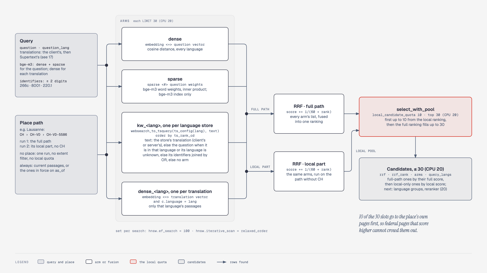

[HTML](19-search-arms.html) · code: [`src/swiss_grounding/serving/candidates.py`](../../src/swiss_grounding/serving/candidates.py) · [`src/swiss_grounding/serving/rrf.py`](../../src/swiss_grounding/serving/rrf.py) · [`src/swiss_grounding/serving/search_service.py`](../../src/swiss_grounding/serving/search_service.py) · [`src/swiss_grounding/corpus/schema.sql`](../../src/swiss_grounding/corpus/schema.sql) · [`src/swiss_grounding/config.py`](../../src/swiss_grounding/config.py)

### 20 · From candidates to citations

Steps 6 to 10 of swiss_search for one place. A passage exists in up to four languages; it is scored once, through the version the user can read, and its other versions count as corroboration. The reranker depends on the hardware, and so does a fitted relevance model.

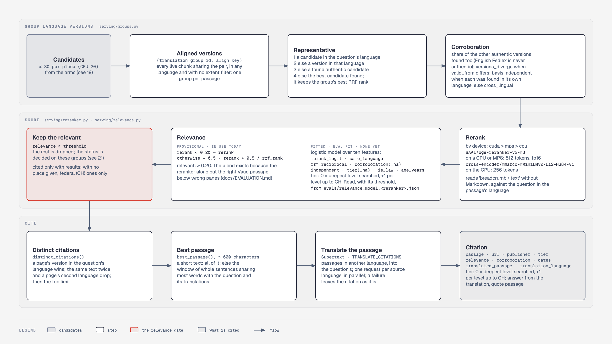

[HTML](20-candidates-to-citations.html) · code: [`src/swiss_grounding/serving/groups.py`](../../src/swiss_grounding/serving/groups.py) · [`src/swiss_grounding/serving/reranker.py`](../../src/swiss_grounding/serving/reranker.py) · [`src/swiss_grounding/serving/relevance.py`](../../src/swiss_grounding/serving/relevance.py) · [`src/swiss_grounding/serving/search_service.py`](../../src/swiss_grounding/serving/search_service.py) · [`src/swiss_grounding/serving/passages.py`](../../src/swiss_grounding/serving/passages.py) · [`src/swiss_grounding/serving/translation.py`](../../src/swiss_grounding/serving/translation.py) · [`docs/EVALUATION.md`](../../docs/EVALUATION.md)

### 21 · Status decision

Every place gets one status, from the first rule that applies. A place is never guessed: an ambiguous one, and a placeless question whose answer depends on where the user lives, are asked back. Which subjects are set locally is decided from the evidence first; the word lists only apply once pages from two or more places answer.

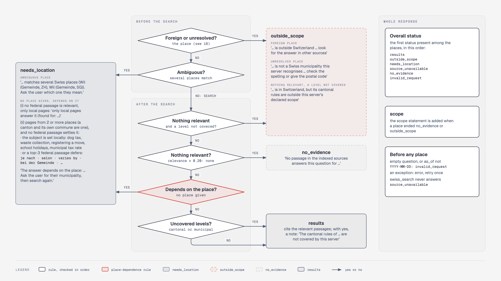

[HTML](21-status-decision.html) · code: [`src/swiss_grounding/serving/status.py`](../../src/swiss_grounding/serving/status.py) · [`src/swiss_grounding/serving/place_dependent.py`](../../src/swiss_grounding/serving/place_dependent.py) · [`src/swiss_grounding/serving/models.py`](../../src/swiss_grounding/serving/models.py) · [`src/swiss_grounding/serving/search_service.py`](../../src/swiss_grounding/serving/search_service.py) · [`src/swiss_grounding/mcp_server/server.py`](../../src/swiss_grounding/mcp_server/server.py)

## Models and configuration

### 22 · Models by stage

Which model runs at each stage, and where. Building the corpus pays for OCR and descriptions, by default with OpenAI through the Batch API; embeddings are made on this machine. Answering a question needs no key: bge-m3 embeds the question and the reranker scores the candidates locally (BAAI/bge-reranker-v2-m3 on a GPU or Apple MPS, cross-encoder/mmarco-mMiniLMv2-L12-H384-v1 on a CPU). eval label and eval generate call CORPUS_DOC_MODEL through OpenAI.

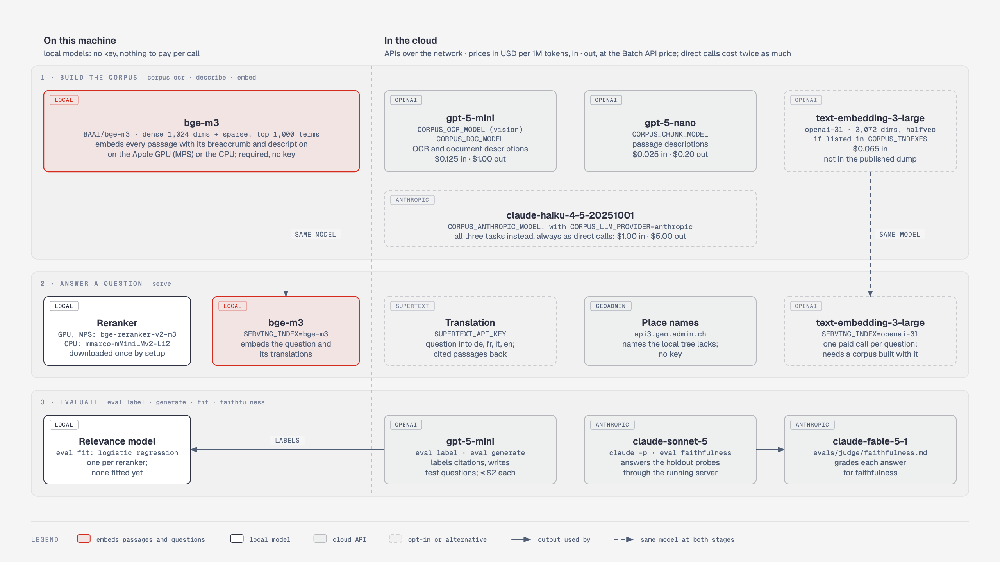

[HTML](22-models-by-stage.html) · code: [`src/swiss_grounding/config.py`](../../src/swiss_grounding/config.py) · [`src/swiss_grounding/corpus/budget.py`](../../src/swiss_grounding/corpus/budget.py) · [`src/swiss_grounding/corpus/providers.py`](../../src/swiss_grounding/corpus/providers.py) · [`src/swiss_grounding/serving/reranker.py`](../../src/swiss_grounding/serving/reranker.py) · [`src/swiss_grounding/app.py`](../../src/swiss_grounding/app.py) · [`src/swiss_grounding/serving/translation.py`](../../src/swiss_grounding/serving/translation.py) · [`src/swiss_grounding/locations/geoadmin.py`](../../src/swiss_grounding/locations/geoadmin.py) · [`src/swiss_grounding/cli/eval_commands.py`](../../src/swiss_grounding/cli/eval_commands.py) · [`evals/judge_harness.py`](../../evals/judge_harness.py)

### 23 · Serving settings

What the server decides from its settings when it starts. Without keys nothing is translated, no parliament tools are listed and the question is embedded locally with bge-m3. The hardware picks the reranker, and the reranker decides which fitted relevance model may be used; until one is fitted, the provisional score applies. Every setting comes from the environment or .env, except HF_HUB_OFFLINE.

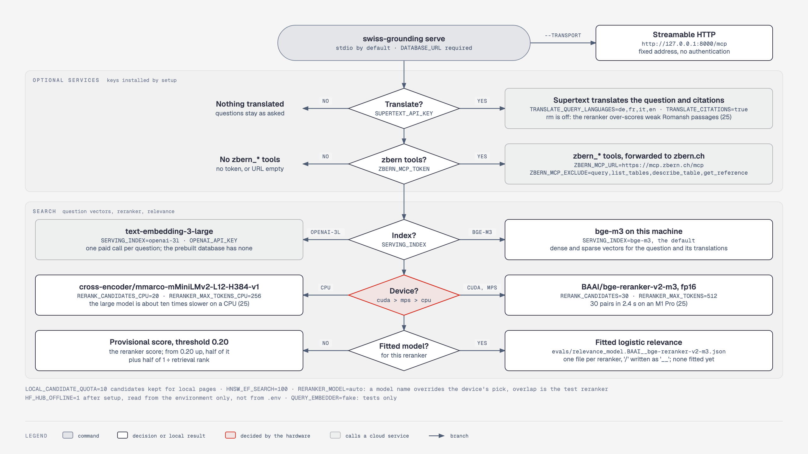

[HTML](23-serving-settings.html) · code: [`src/swiss_grounding/config.py`](../../src/swiss_grounding/config.py) · [`src/swiss_grounding/app.py`](../../src/swiss_grounding/app.py) · [`src/swiss_grounding/serving/reranker.py`](../../src/swiss_grounding/serving/reranker.py) · [`src/swiss_grounding/serving/relevance.py`](../../src/swiss_grounding/serving/relevance.py) · [`src/swiss_grounding/serving/translation.py`](../../src/swiss_grounding/serving/translation.py) · [`src/swiss_grounding/mcp_server/zbern.py`](../../src/swiss_grounding/mcp_server/zbern.py) · [`src/swiss_grounding/cli/main.py`](../../src/swiss_grounding/cli/main.py)

### 24 · Corpus build settings

How the paid stages are called and what they may spend. CORPUS_LLM_PROVIDER defaults to fake, so a real build sets openai or anthropic with its key. OpenAI calls go through the Batch API unless --sync is passed; Anthropic calls are always direct. The local bge-m3 index needs EMBEDDING_BACKEND=sentence_transformers; the OpenAI index is opt-in and paid. Every paid stage stops at CORPUS_BUDGET_USD.

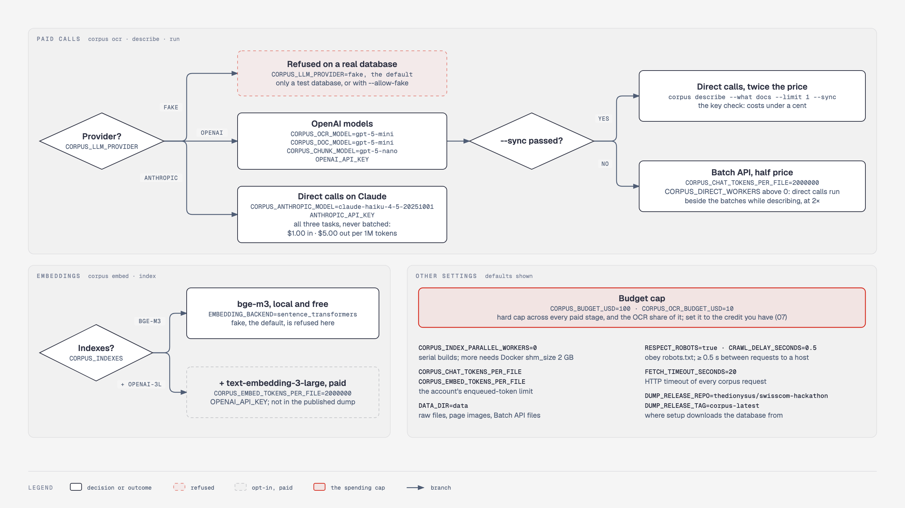

[HTML](24-build-settings.html) · code: [`src/swiss_grounding/config.py`](../../src/swiss_grounding/config.py) · [`src/swiss_grounding/cli/corpus_commands.py`](../../src/swiss_grounding/cli/corpus_commands.py) · [`src/swiss_grounding/cli/corpus_run.py`](../../src/swiss_grounding/cli/corpus_run.py) · [`src/swiss_grounding/corpus/budget.py`](../../src/swiss_grounding/corpus/budget.py) · [`src/swiss_grounding/corpus/providers.py`](../../src/swiss_grounding/corpus/providers.py) · [`docs/MAINTAINING.md`](../../docs/MAINTAINING.md)

### 25 · Reranker findings

Why the scorer and the hardware settings look the way they do. Within one language the cross-encoder separates relevant from irrelevant passages sharply, but it scores the same article in another language as if it were irrelevant; on a CPU the large model is about ten times slower. Measured on 23 and 24 September 2026 on an Apple M1 Pro with 16 GB; the numbers are in docs/EVALUATION.md.

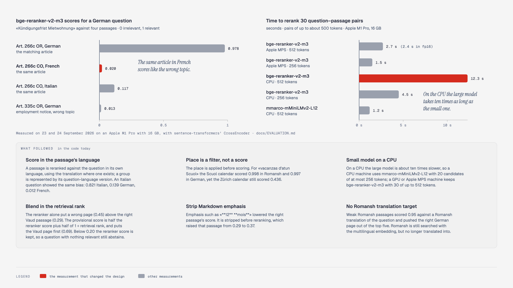

[HTML](25-reranker-findings.html) · code: [`src/swiss_grounding/serving/reranker.py`](../../src/swiss_grounding/serving/reranker.py) · [`src/swiss_grounding/serving/relevance.py`](../../src/swiss_grounding/serving/relevance.py) · [`src/swiss_grounding/serving/search_service.py`](../../src/swiss_grounding/serving/search_service.py) · [`src/swiss_grounding/config.py`](../../src/swiss_grounding/config.py) · [`docs/EVALUATION.md`](../../docs/EVALUATION.md)

## Architecture and evaluation

### 26 · System architecture

What answers a question at query time. The MCP client starts swiss-grounding serve and talks to it over stdio, or connects over streamable HTTP at http://127.0.0.1:8000/mcp, which has no authentication. Everything runs on the local machine except five outside services; Supertext is called only with SUPERTEXT_API_KEY and zbern.ch only with ZBERN_MCP_TOKEN. The lookups also read serving.premium and keep the reference rate in serving.lookup_cache. With the default SERVING_INDEX=bge-m3, no LLM or embedding API is called while serving.

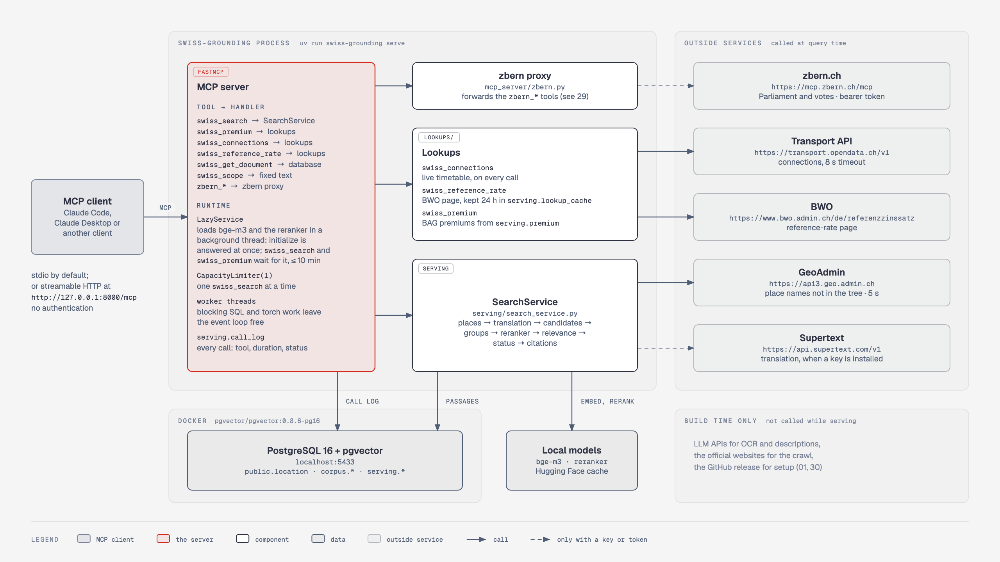

[HTML](26-system-architecture.html) · code: [`src/swiss_grounding/mcp_server/server.py`](../../src/swiss_grounding/mcp_server/server.py) · [`src/swiss_grounding/mcp_server/zbern.py`](../../src/swiss_grounding/mcp_server/zbern.py) · [`src/swiss_grounding/app.py`](../../src/swiss_grounding/app.py) · [`src/swiss_grounding/serving/search_service.py`](../../src/swiss_grounding/serving/search_service.py) · [`src/swiss_grounding/config.py`](../../src/swiss_grounding/config.py) · [`docker-compose.yml`](../../docker-compose.yml)

### 27 · A conversation over MCP

The challenge's first question, asked without a place. The assistant is a chat model inside an MCP client; tools/call is the MCP JSON-RPC method, and every tool result is JSON text. The zbern_* tools are listed only when the zbern token is installed (29). The needs_location reply is what the server returned on 25 September 2026 against the local corpus, shortened: empty and null fields are left out (28 has them all). The second reply depends on the municipality the user names, so its citations are not shown.

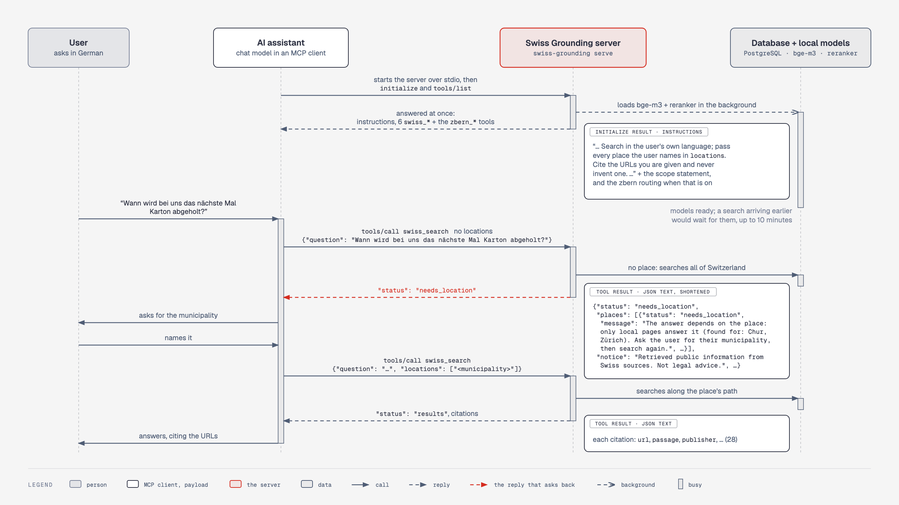

[HTML](27-mcp-conversation.html) · code: [`src/swiss_grounding/mcp_server/server.py`](../../src/swiss_grounding/mcp_server/server.py) · [`src/swiss_grounding/serving/search_service.py`](../../src/swiss_grounding/serving/search_service.py) · [`src/swiss_grounding/serving/status.py`](../../src/swiss_grounding/serving/status.py) · [`src/swiss_grounding/serving/place_dependent.py`](../../src/swiss_grounding/serving/place_dependent.py) · [`src/swiss_grounding/serving/models.py`](../../src/swiss_grounding/serving/models.py)

### 28 · Anatomy of a swiss_search reply

Every field of a swiss_search reply, nested as in the JSON. When places disagree, the overall status is the first of results, outside_scope, needs_location, source_unavailable, no_evidence and invalid_request that any place has. scope is an empty string and field is null unless they apply. Two replies are shorter: error carries only status, message and notice, and the invalid_request for a malformed as_of adds field.

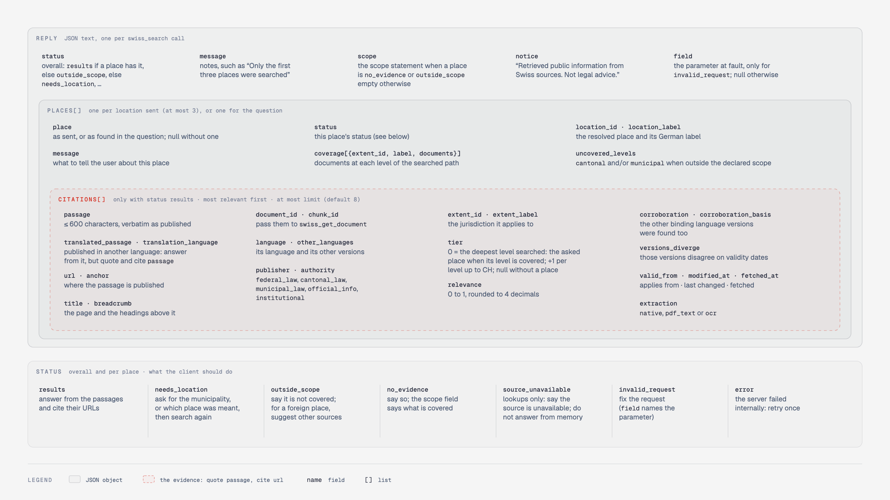

[HTML](28-reply-anatomy.html) · code: [`src/swiss_grounding/serving/models.py`](../../src/swiss_grounding/serving/models.py) · [`src/swiss_grounding/serving/search_service.py`](../../src/swiss_grounding/serving/search_service.py) · [`src/swiss_grounding/serving/status.py`](../../src/swiss_grounding/serving/status.py) · [`src/swiss_grounding/mcp_server/server.py`](../../src/swiss_grounding/mcp_server/server.py)

### 29 · zbern proxy

How the zbern.ch Parliament tools are served beside our own. The proxy is on when ZBERN_MCP_URL is not empty (default https://mcp.zbern.ch/mcp) and ZBERN_MCP_TOKEN is set; setup installs the token from the release. Nothing about the zbern tools is hard-coded: names, descriptions, input schemas and instructions come from the remote server, so its changes show up without a change here.

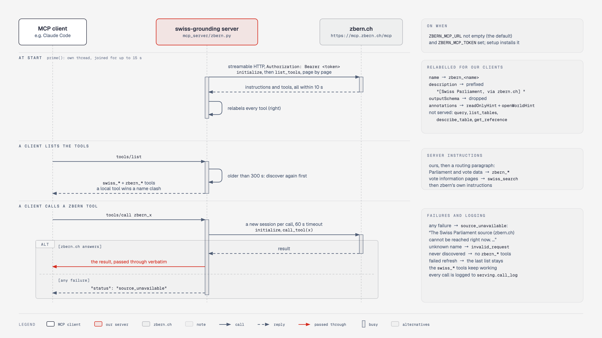

[HTML](29-zbern-proxy.html) · code: [`src/swiss_grounding/mcp_server/zbern.py`](../../src/swiss_grounding/mcp_server/zbern.py) · [`src/swiss_grounding/mcp_server/server.py`](../../src/swiss_grounding/mcp_server/server.py) · [`src/swiss_grounding/config.py`](../../src/swiss_grounding/config.py)

### 30 · Release and setup

How the prebuilt database travels from the maintainer's machine to a collaborator's. The release lives in the private repository, so gh downloads it with the collaborator's own login. The call log and the lookup cache stay behind; the location tree, the corpus with its descriptions and bge-m3 vectors, and the premium tables are included. HF_HUB_OFFLINE is read from the environment only, not from .env.

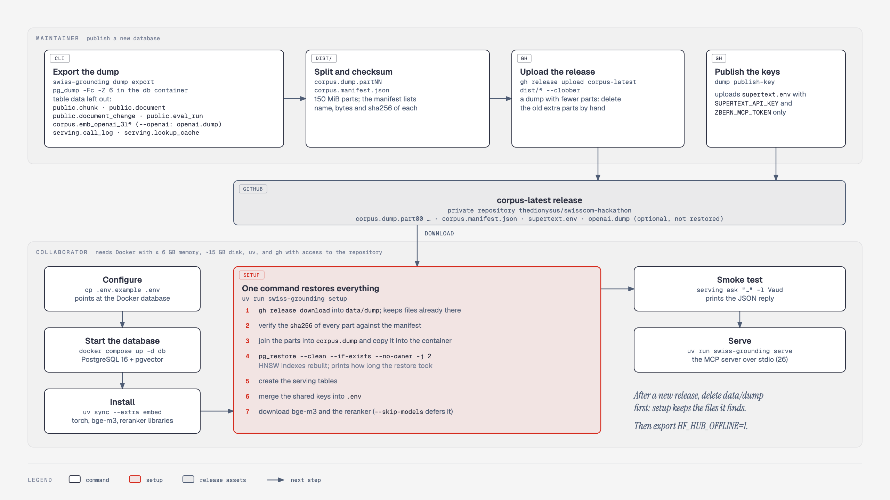

[HTML](30-release-and-setup.html) · code: [`src/swiss_grounding/cli/serving_commands.py`](../../src/swiss_grounding/cli/serving_commands.py) · [`src/swiss_grounding/serving/dump.py`](../../src/swiss_grounding/serving/dump.py) · [`src/swiss_grounding/serving/secrets.py`](../../src/swiss_grounding/serving/secrets.py) · [`docs/MAINTAINING.md`](../../docs/MAINTAINING.md) · [`README.md`](../../README.md)

### 31 · Evaluation loop

How answer quality is measured. The loop turns labelled dev citations into a fitted relevance model and reports on the holdout split; eval fit asks for more labels when no threshold reaches 0.9 precision. Until a model is fitted, the server keeps its provisional score. Faithfulness was 12 of 12 on 2026-09-24, measured with the zbern tools on.

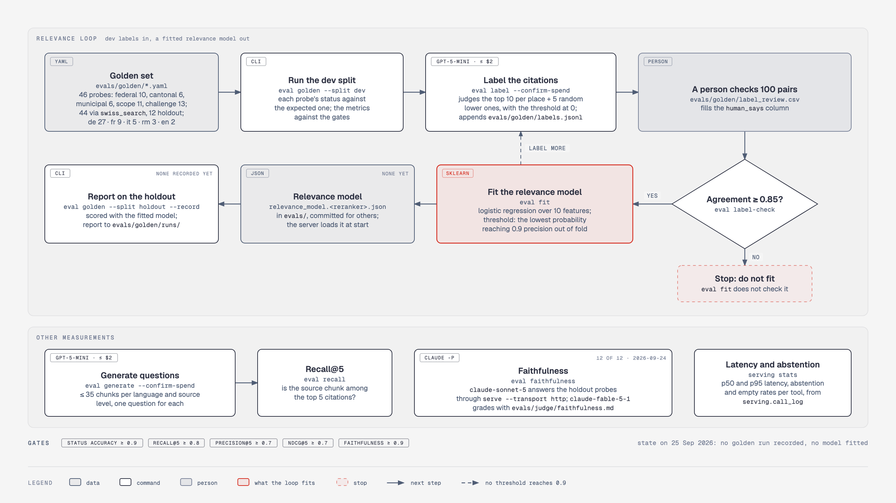

[HTML](31-evaluation-loop.html) · code: [`docs/EVALUATION.md`](../../docs/EVALUATION.md) · [`src/swiss_grounding/cli/eval_commands.py`](../../src/swiss_grounding/cli/eval_commands.py) · [`evals/fit.py`](../../evals/fit.py) · [`evals/metrics.py`](../../evals/metrics.py) · [`evals/labels.py`](../../evals/labels.py) · [`src/swiss_grounding/serving/relevance.py`](../../src/swiss_grounding/serving/relevance.py)
